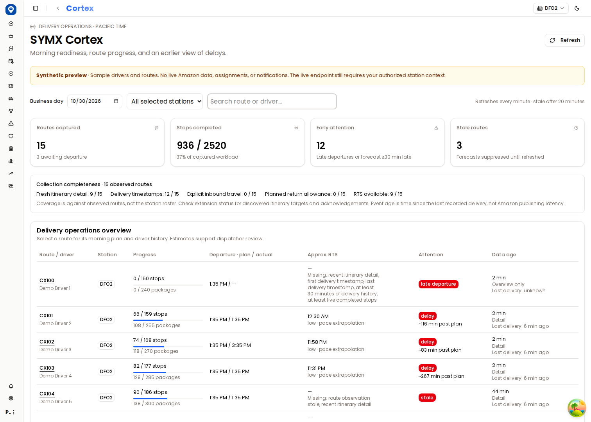
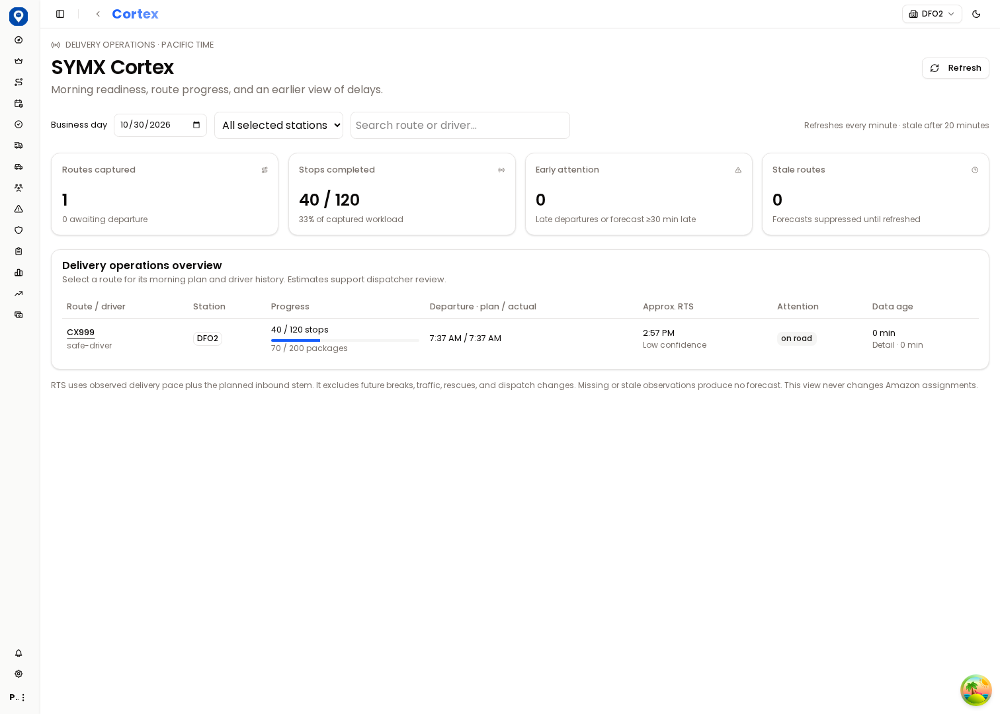

# SYMX Cortex MVP

Development branch: `feature/symx-cortex-mvp`, based on draft PR #12. No production merge or deployment is part of this work.

## What works

- `/cortex` adds a read-only delivery operations dashboard under Dispatching → SYMX Cortex, using existing office authentication, Dispatching view permission, and server-side station scoping.
- Overview: planned/actual departures, stop/package progress, capture age, overview/detail coverage, delay attention, and route search. Select a route for its morning plan and the driver's last 14 days of captured history at that station.
- RTS is a low-confidence estimate from at least five completed stops and 30 minutes of observed delivery work, plus planned inbound stem. Stale observations (over 20 minutes) and insufficient data suppress predictions. A forecast ≥30 minutes past plan or departure >15 minutes late raises an attention flag. Traffic, future breaks, rescues, and route changes are not predicted. No automated dispatch decisions are made.
- `symx-cortex-extension/` is a separate, opt-in MV3 development collector. It observes successful requests made by the signed-in Amazon page, including overview and pre-start `RMSRoute` details, and navigates the page to individual routes. It never signs or directly issues Amazon API requests, spoofs visibility, modifies assignments, or automates login.
- Collection is staggered across configured DFO2, DXC8, and DFO3 service areas, every ten minutes from 07:00 through 23:59 Pacific while Chrome is running. Existing open Cortex pages also provide passive observations. Browser suspension or signed-out sessions are reported as partial/timeout, not success.
- The partner's extension is untouched. The legacy `chrome-extension/` directory is untouched relative to PR #12; its three foundation commits are inherited.

## Run the isolated preview

```sh
cd /workspace/SYMXSystems
npm ci
npx playwright install chromium
node scripts/cortex-dev.mjs
```

This starts Next.js on port 3000 and a fresh loopback-only MongoDB database named `symx-cortex-disposable`. It generates random local-only login, JWT, and ingest credentials, held privately in `/tmp/symx-cortex-preview.json` (mode 0600), and removes that file on shutdown. Production MongoDB environment values are overridden for the child process. First run of MongoDB needs `fastdl.mongodb.org`; browser installation needs Playwright's official CDN. Keep TLS and artifact checks enabled.

In a second terminal:

```sh
node scripts/cortex-smoke.cjs
node scripts/cortex-extension-smoke.cjs
```

The first script logs in with the generated test account, seeds three synthetic stations **only in the named local disposable database**, tests desktop/mobile UI, tests extension normalization → HTTP ingest → persistence → dashboard, and checks duplicate delivery. It recreates that database's Cortex observations, so run it only against the disposable preview. Screenshots are written to `artifacts/cortex-*.png`.

The second loads the actual unpacked extension in Playwright Chromium. Every Amazon URL is intercepted and fulfilled with synthetic fixtures; no live Amazon traffic or credentials are used. It tests overview interception, route navigation, detail capture, server acknowledgment, and reconciled readback.

For manual browser access, use the standard `/login` flow with the generated local test credentials read privately from the state file, then visit `/cortex?demo=1` for labeled fixtures or `/cortex` for ingested synthetic observations. Do not paste credentials into logs or commit the private state file. Demo responses require authentication, Dispatching access, `NODE_ENV=development`, and `SYMX_CORTEX_DEMO=true`; demo data is unavailable in production. Screenshot links below provide a reviewable preview when cloud port sharing is unavailable.




## Connect an authorized Chrome session to a test environment

1. Keep production and partner extensions unchanged. Use a separate Chrome development profile; avoid running both SYMX collectors in that profile because each patches the same page request functions.
2. In `chrome://extensions`, enable developer mode and load `symx-cortex-extension/` unpacked.
3. Open its settings. Enter the local or isolated Vercel preview origin and a dedicated `SYMX_CORTEX_KEY` matching the test server. The production hostname is explicitly rejected and collection is disabled until opted in. Neither keys nor service area IDs are shipped in the extension.
4. Enter the actual authorized service area IDs for DFO2, DXC8, and DFO3 and enable collection. The server must have active Site records mapping those IDs to those station codes. Use authorized mappings; do not infer or substitute stations.
5. Sign in normally to Cortex in that Chrome profile. Review per-station health, confirmed success, observed timestamp, pending deliveries, permanent failures, and collection completeness in extension settings. Only jobs opened by this extension are closed after completion/timeout.
6. Reload the extension after changing its source. On a machine using the disposable preview, settings credentials come from its private state file; they change each restart.

The collector accepts only localhost or isolated `*.vercel.app` origins, and rejects the production app hostname. A future custom staging domain would need an explicit code/manifest change. The new `/api/public/symx-cortex` endpoint has no embedded-key fallback and is disabled (503) without `SYMX_CORTEX_KEY`. No new production environment values have been configured.

## Reliability and data boundaries

The worker durably stores a bounded outbox before delivery (maximum 300 minimal captures), serializes storage mutations, and retries transient failures with exponential backoff, a 15-second HTTP timeout, and a twelve-attempt/seven-day budget. Pending data survives MV3 restarts. A capture has a deterministic UUID derived from station/date/kind/minute/normalized content; retries keep that ID. A unique `(siteId,captureId,routeCode,driverId)` index and insert-only writes make repeated and concurrent submissions idempotent. Index creation is awaited before accepting writes.

Permanent failures retain the last 20 normalized captures for diagnosis/retry; old failures require recollection. Retry does not change capture timestamps. The popup exposes failed delivery state and allows redriving non-expired failures after configuration is corrected. Configuration changes cannot redirect queued captures to another environment.

The server validates the dedicated key, body size, date, timestamp, counters, route uniqueness, and active station mapping before writes. It does not write existing route/assignment collections or invoke alerts, messaging, payments, migrations, or dispatch actions. It stores only normalized operational metrics and driver ID/name, not customer addresses, tracking IDs, phone numbers, or raw stops. Observation retention is 35 days (MongoDB TTL cleanup is asynchronous).

Read APIs authorize before querying, apply `siteFilter` in MongoDB, and return no data for an empty station scope. They select latest observations by capture time, not arrival time. Overview/detail data are reconciled into one current row per station/day/route; detail age remains visible and old detail cannot supply a current forecast. Driver history is limited to the selected station scope and the previous 14 days. This is captured history, not an imported Amazon historical archive.

## Validation and live acceptance

Automated coverage includes real MongoDB ingestion, duplicate retries, out-of-order arrivals, malformed and future captures, bad keys and unknown stations, empty/unrelated scopes, permission denials, production demo rejection, Pacific dates/DST, stale and insufficient-data forecasts, normalizers, restart recovery, concurrency, permanent failures, opt-in controls, and production-origin rejection. Existing model guard/registry regressions were corrected without changing their access model.

Before approving use with real data, validate all three station mappings and current Amazon response shapes in an authorized session, especially pre-start RMSRoute details, route/driver reassignment and rescues, planned return timestamps, Chrome background throttling, full route coverage within the eight-minute run budget, browser restart recovery, and RTS accuracy against actual returns. Large stations may take more than eight minutes to visit every route; partial captures remain explicit. Service area IDs and live Cortex authentication are not available in this cloud task.

No shared cloud preview URL is generated by this environment's tools. The local authenticated preview, reproducible smoke commands, and captured screenshots are provided instead. Production rollout, monitoring, credential rotation, and any merge require separate review.

### Recorded results

- Full Vitest regression: **294 passed, 23 files, zero skipped/failed** (local MongoDB).
- TypeScript check passed; optimized Next.js build passed during implementation. Final build status is also recorded in the draft PR.
- Authenticated Chromium dashboard smoke passed, including desktop/mobile screenshots, filters, morning summary, driver history, real normalized ingest, duplicate delivery, and unauthenticated API rejection.
- Actual unpacked MV3 extension smoke passed in Playwright Chromium: four intercepted synthetic Amazon GETs, overview/detail capture and navigation, server acknowledgments, and reconciled route readback. Zero live Amazon requests.
- Frozen-lockfile dry-run passed. Existing runtime dependency versions and optional-peer lock entries were preserved; only the pinned Playwright test dependency and its packages were added.


### Recovery follow-up (collector 0.1.1)

Recovery drains up to 40 ready captures per minute tick, yielding after a 20-second catch-up budget (an in-flight request retains its 15-second timeout). It releases the storage lock between requests, shares concurrent drain requests, and stops on the first transient failure. This prevents recovered queues from being limited to one capture per minute while avoiding a burst of retries during an outage.

A bounded journal of 1,000 explicit server receipts prevents duplicate sends after successful delivery and worker restarts. A capture is acknowledged only when the server confirms its ID and every route count; disappearance from a queue is never evidence of delivery. Replaying older captures cannot move a station's observed freshness backwards.

Settings now pass through the worker's storage transaction queue. An environment switch is refused while captures, failures, or owned collection jobs remain. A permitted switch clears environment-specific receipts and health. Disabling collection closes only the tabs registered as this extension's jobs. Existing production hostname rejection and station validation are enforced again inside the worker. Reload the unpacked extension to activate version 0.1.1.
